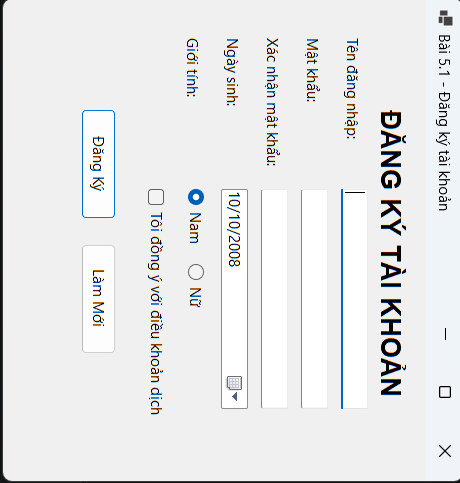
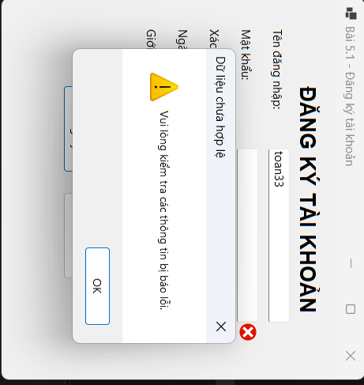
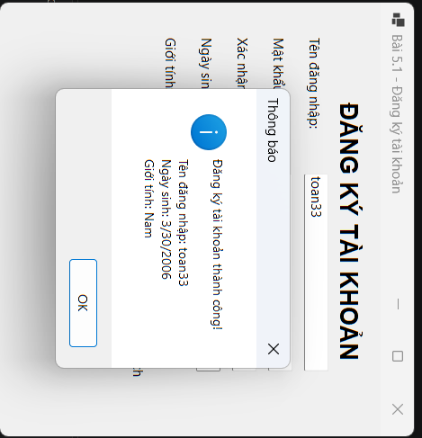

# BÀI 5.1: FORM ĐĂNG KÝ TÀI KHOẢN VÀ BẮT LỖI GIAO DIỆN

## THÔNG TIN SINH VIÊN

- **Họ và tên:** Đỗ Quang Toàn
- **Mã số sinh viên:** 24810320100
- **Lớp:** D19QTANM1
- **Môn học:** Lập trình .NET

## KẾT QUẢ THỰC HÀNH

### 1. Giao diện chính

### 2. Kiểm tra lỗi ErrorProvider

### 3. Đăng ký thành công

